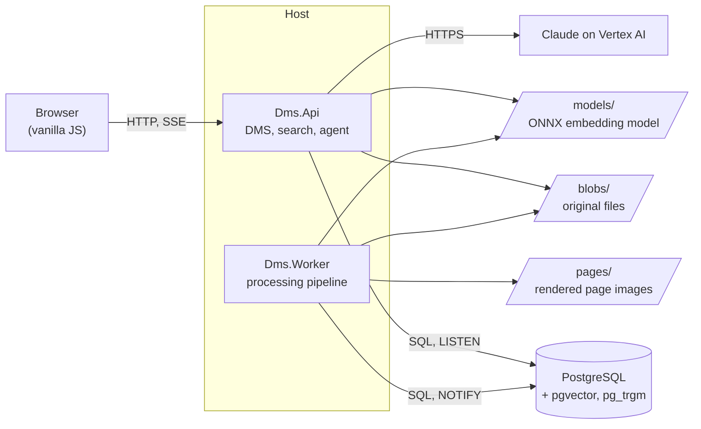
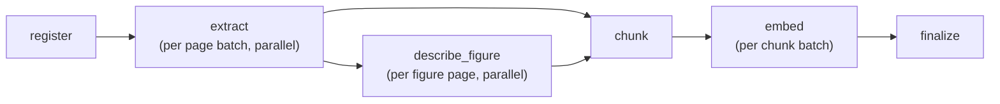

# Architecture

This is an English summary of the architecture. The full specification, including the reasons
behind each decision, is in [`planning/spec.hu.md`](planning/spec.hu.md) (Hungarian). Individual
decisions are recorded as ADRs in [`adr/`](adr/).

## Overview

The system is a minimal document management system (DMS) with hybrid search and an agentic
assistant on top. Every component is written in C#. PostgreSQL is the only data store: relational
data, full-text search and vectors (pgvector) all live in one database, so a processing step can
write its results in a single transaction.

- **Dms.Api** serves the DMS endpoints (collections, documents, versions, tags), search, the agent
  and server-sent events. It creates the first job of every upload.
- **Dms.Worker** is a separate process that takes jobs from the `job` table and runs the
  processing pipeline.
- The API and the Worker never reference each other. They communicate only through the database:
  the `job` table carries work, `LISTEN/NOTIFY` carries signals.
- Query and document embeddings use the same local ONNX model, so no document text leaves the
  machine for embedding.

## Solution layout and dependency rules

| Project | Responsibility | May reference |
| --- | --- | --- |
| `Dms.Core` | Domain model, interfaces, pure logic | nothing in the solution; no infrastructure packages |
| `Dms.Infrastructure` | EF Core + pgvector, blob store, PDF, ONNX, LLM clients | `Core` |
| `Packs/Dms.Packs.*` | Domain packs (see below) | `Core` |
| `Dms.Api` | HTTP API | `Core`, `Infrastructure`, `ServiceDefaults` |
| `Dms.Worker` | Job processing | `Core`, `Infrastructure`, `ServiceDefaults` |
| `Dms.MigrationService` | Applies EF Core migrations once, before Api and Worker start | `Core`, `Infrastructure`, `ServiceDefaults` |
| `Dms.ServiceDefaults` | OpenTelemetry, health checks, resilience defaults | — |
| `Dms.AppHost` | .NET Aspire orchestration for local development | the runnable projects |

Architecture tests enforce these rules on every build.

## Data model

The schema is owned by EF Core migrations. All IDs are UUID v7. Tables are created in the
milestone that first uses them, so early migrations do not fix the shape of later features.

| Area | Tables |
| --- | --- |
| DMS core | `collection`, `document`, `document_version`, `tag`, `document_tag`, `audit_log`, Identity tables |
| Processing | `job`, `page`, `page_label`, `block` |
| Retrieval | `chunk` (text, generated `tsvector`, `embedding vector`), `chunk_code`, `section_link` |
| Agent | `conversation`, `message` |
| Evaluation | `eval_case`, `eval_run` |
| Domain packs | own PostgreSQL schema per pack (e.g. `automotive.vehicle`, `automotive.service_log`) |

Key points:

- **Active version only.** A document has versions; only the active one is searchable. Every
  search branch filters on a denormalised `chunk.active` flag, which is switched in the same
  transaction as `document.active_version_id`. Activation, rollback and soft delete are therefore
  atomic and immediate.
- **Content-addressed blobs.** Original files are stored as `blobs/ab/cd/<sha256>` behind
  `IBlobStore`; identical content is stored once.
- **Codes are not full text.** Codes such as fault codes or part numbers are extracted into
  `chunk_code` for exact and trigram matching, because the default PostgreSQL text parser splits
  them.

## Processing pipeline

Uploading a file creates a `document_version` and a `register` job. Each step is a separate job
type, so it can be retried, resumed and observed.

| Job | What it does |
| --- | --- |
| `register` | Opens the file, rejects permanent errors, reads the outline, detects repeated headers and footers, plans page batches |
| `extract` | Extracts text blocks with coordinates, classifies and renders pages; OCR on scanned pages later |
| `describe_figure` | Describes diagrams and images with a vision model (later milestone) |
| `chunk` | Builds chunks from blocks along the outline, runs enrichers, builds cross-references; bulk write with `COPY` |
| `embed` | Tokenises, batches, runs ONNX inference, pools and normalises; writes vectors in one transaction |
| `finalize` | Checks that every chunk has a vector and activates the version conditionally |

All extractors translate their input into one **unified block model** (page → blocks with type,
text, bounding box, source and confidence). Chunking only sees this model, so new formats and OCR
plug in behind interfaces without changing the pipeline:
`IFormatExtractor`, `IPageClassifier`, `IOcrEngine`, `IChunker`, `IEnricher`.

### Job queue

- **Claiming:** a single `UPDATE … FROM (SELECT … FOR UPDATE SKIP LOCKED)` statement moves a job to
  `running` and gives it a lease; a heartbeat extends the lease while the job runs.
- **Run ID:** every processing run of a version has a `run_id`. A job whose `run_id` is no longer
  current writes nothing, so an abandoned run cannot mix with a newer one.
- **Fan-in:** `document_version.pending_jobs` counts unfinished jobs of the current step. The job
  that decrements it to zero creates the next step's job.
- **Idempotency:** a job replaces its own previous results in the same transaction it writes the
  new ones.
- **Failures:** transient errors are retried with exponential backoff and jitter, then moved to
  dead-letter; permanent errors fail the version immediately with a readable message.
- **Zombie protection:** closing a job is conditional on still holding the lease.
- **Planned shutdown:** on SIGTERM the Worker stops claiming, lets running jobs finish for a bounded
  time, and hands back the rest without consuming an attempt.

### Notifications

`LISTEN/NOTIFY` carries signals, never data; the tables are always the source of truth.

- `job_available` wakes idle Workers immediately; polling remains as a fallback.
- `version_progress` is sent from the Worker's closing transaction (delivered only on commit). The
  API listens on a dedicated connection and fans events out to open SSE connections.
- On reconnect, clients and listeners read the current state from the tables, so a lost
  notification causes no drift.

## Search

Search is always scoped to one collection. Three branches run in parallel and are fused in C#:

| Branch | Source | Good for |
| --- | --- | --- |
| Code | `chunk_code`, exact and trigram match | Fault codes, connector and part numbers |
| Lexical | PostgreSQL `tsvector` with the collection's `ts_config` | Exact terms |
| Semantic | pgvector HNSW index (cosine), partial on active chunks | Descriptions and paraphrases |

Exact code matches come first; the rest is combined with Reciprocal Rank Fusion. Every change to
search is measured against the evaluation set (Recall@5, Recall@10, MRR) before it is accepted.

## Embedding

Embeddings are computed locally with ONNX Runtime behind `IEmbeddingGenerator`. Tokenisation
(`Microsoft.ML.Tokenizers`), batching, inference, mean pooling and L2 normalisation are written by
hand as a learning goal. The default model is `multilingual-e5-base` (768 dimensions), which puts
Hungarian questions and English text in the same vector space. Models are downloaded by a script
and verified by hash; they are not in the repository.

## Agent

The agent is a hand-written tool-use loop over Claude on Vertex AI, without an agent framework:
call the model, execute the requested tools, return the results, repeat until the model answers.

- **Tools** are a fixed allow-list: general tools (`list_collections`, `search`, `get_chunk`,
  `get_toc`, `lookup_code`, `get_page_image`, `render_diagram`) plus the tools of the collection's
  domain pack. Tools that write require user confirmation.
- **Limits** per turn on tool calls, time and images; when a limit is hit, a final call without
  tools asks for an answer from what has been gathered.
- **Citations:** the model cites chunk IDs; the server turns them into document and page links only
  if a tool actually returned that chunk in the conversation.
- **Untrusted content:** retrieved document text is wrapped and treated as data, never as
  instructions.
- **Streaming:** the answer, tool calls and tool results stream to the browser over SSE.

## Domain packs

The core system is domain-agnostic. Domain knowledge lives in a **domain pack** implementing
`IDomainPack`; a collection selects at most one pack via `collection.domain_pack`. Without a pack
the general behaviour applies end to end, which is how the demo corpus runs.

A pack can provide chunking options, enrichers, page classifier thresholds, cross-reference
patterns, a domain part of the agent's system prompt, extra agent tools, and its own tables in its
own PostgreSQL schema with its own `DbContext` and migrations. The agent's system prompt is the
general part plus the pack's part; its tools are the general tools plus the pack's tools.

The first pack, `Dms.Packs.Automotive`, provides fault-code, connector, part-number and torque
enrichers, a diagnostic workflow for the agent, and vehicle profile and service history.

## Cross-cutting concerns

- **Configuration:** strongly typed, validated `IOptions<T>` (`Llm`, `Embedding`, `Database`,
  `Storage`); secrets in user-secrets locally and `.env` when deployed.
- **Observability:** OpenTelemetry through .NET Aspire; one span per model call and per tool call,
  with token usage.
- **Resilience:** outbound HTTP through `IHttpClientFactory` with a resilience pipeline;
  `CancellationToken` everywhere.
- **Security:** cookie authentication with ASP.NET Core Identity; upload size limits, content-based
  type detection and path traversal protection.
- **Testing:** unit tests for pure logic, integration tests with Testcontainers (PostgreSQL with
  pgvector), architecture tests. Tests and CI never call a real LLM or external embedding API.

## Deployment

- **Development:** `dotnet run --project src/Dms.AppHost` starts PostgreSQL, the API and the Worker
  with the Aspire dashboard.
- **Self-hosted:** a Docker Compose stack (`postgres`, `api`, `worker`) with volumes for database
  data, `blobs/`, `pages/` and `models/`, reachable on the local network only.
